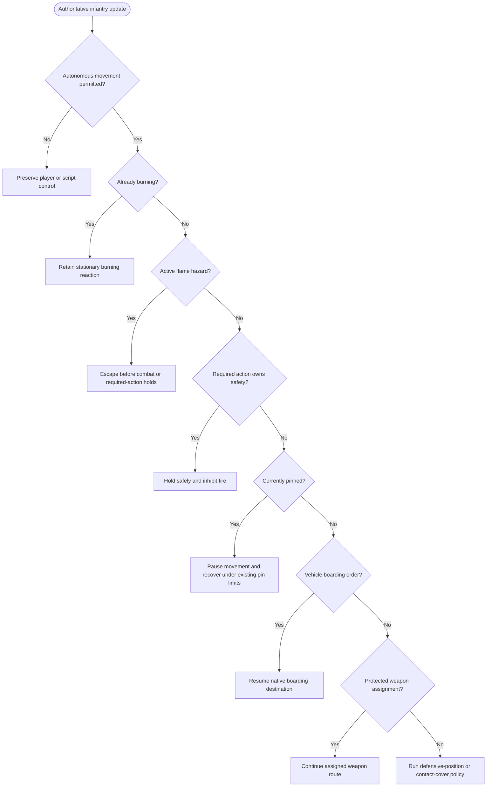
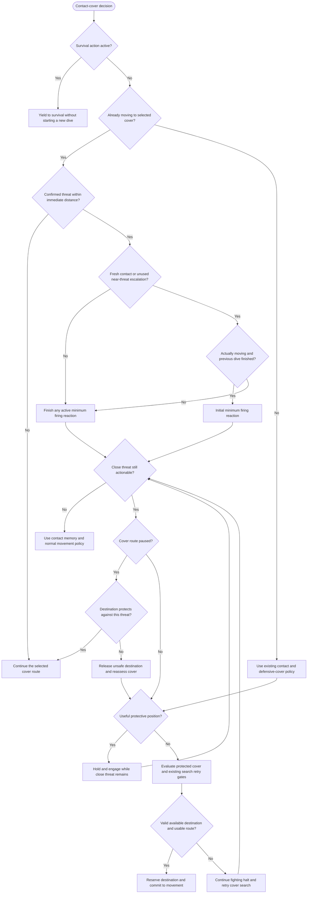

# Infantry AI decision flow

This describes the ground infantry decision changes made on September 16, 2026.
It maps the current director and contact-response code, rather than proposing a
replacement for the game's entire AI. Vehicle combat, weapon selection, and perception
retain their existing policies. The objective updates below describe the subsequent
October 3 and October 13 changes to objective allocation.

## Priority conflicts corrected

| Competing decisions | Earlier behavior | Corrected behavior |
|---|---|---|
| Escape active flames vs. reload, grenade throw safety, or stalled-route callback | A declared safety halt could defeat escape even though the director selected it. | Escape outranks interruptible holds in the final movement arbiter. Already-burning soldiers retain the separate stationary reaction. |
| Being pinned vs. boarding a vehicle or static weapon | Boarding had higher proposal authority; the local suppression executor could disagree with it. | The current latched pin wins. Boarding resumes when the pin clears. |
| Light suppression vs. tactical movement | The snapshot used the crouch threshold as if it meant a full pin. | Suppression updates before the snapshot; only the latched pin selects the suppression movement executor. Light suppression still affects posture. |
| New distant enemy vs. a committed move into cover | A new contact could arm a firing dive and stop the cover move. | A confirmed threat outside the immediate-threat distance does not start a dive during that move. |
| New nearby enemy vs. a committed move into cover | Contact continuity could prevent a new response even as a distant threat became close. | A close threat may trigger an initial firing reaction. Expiry reassesses protection; a paused destination must protect against the close threat before movement resumes. |
| Live close enemy vs. expired firing or attack-halt timer | Expiry could resume movement without evidence that the threat had cleared. | Continue engagement from protection or while seeking it. A live actionable close threat vetoes objective advances and charges, including advances forced by halt limits. |
| Pin or required action vs. a new firing dive | A dive could be armed before the contact FSM handled the pin. | Survival ownership is checked first; it cannot arm a competing new dive. |

## Selecting the movement executor

Player and mission-script ownership are an outer boundary. The existing player-hold
exception lets AI squadmates occupy cover within the ordered area. This change does
not take over the player's soldier or replace mission-script orders.



The runtime path is `GroundAiDirector.UpdateSoldier` through snapshot collection,
`ProposalGenerationCore.Collect`, and tactical arbitration. The final locomotion
write also passes through `MovementArbiterCore.Resolve`: a high-level decision cannot
be undone by a lower-ranked safety callback. Its survival order is burning hold,
hazard escape, required-action/stall safety, then pinning. Existing ordinary combat,
cover, and spacing ownership follows below those.

## Distance-sensitive cover movement



Distance means horizontal distance to a personally actionable, observed target.
Both the immediate acquisition callback and the regular contact FSM use
`ContactReactionPolicyCore.IsImmediateThreat`. The boundary is inclusive and uses the
existing `ImmediateFireDistanceMeters` setting, scaled by AI aggressiveness
(`AiBehaviorTuning.ImmediateFireDistance`); its unscaled compiled default is
20.103 metres. No new magic distance or visibility privilege is introduced.

A confirmed enemy at 10 m can interrupt a committed cover move at the baseline
setting; one at 75 m cannot start that interruption. The close response halts in the
soldier's current stance, avoiding a prone transition before the first shot. That
stance is selected once and held for the existing firing commitment; a soldier
already prone stays prone. A distant first contact outside a committed cover move
retains the protective dive. A continuous distant contact
that becomes close can escalate once. The same contact episode cannot repeatedly
restart the minimum reaction by changing targets or crossing the threshold. A contact
lapse starts a new episode under the existing continuity rule. Active reactions finish
their existing deadline; a new proposal does not extend it. That deadline is a
reassessment point, not evidence that the enemy has been neutralized.

While a close enemy remains actionable, neither covering fire nor an expired attack
halt limit authorizes ordinary objective advance. A soldier in usable protection
continues engaging; an exposed soldier can seek cover, including outside the attack
waypoint corridor. A paused cover route is checked against the current close enemy
before resuming. If the destination is no longer protective, its reservation is
released and the ordinary cover search/retry policy takes over. Failed or deferred
searches retain the fighting halt. This allows repeated firing opportunities without
restarting the initial dive or freezing out protective movement. Losing sight is not
treated as a confirmed kill: existing contact memory and reacquisition rules apply.

Fire permission remains independently constrained by required actions, hazards,
suppression shock, moving-fire weapon rules, target acquisition, and existing
friendly-fire checks. Winning a movement decision does not itself authorize a shot.

## Verification

The deterministic scenarios cover all 16 combinations of hazard, required action,
pinning, and boarding against competing cover/assignment proposals, with contact
response enabled and disabled and proposal submission order reversed. They also
cover safety callbacks during escape, burning holds, near/far and boundary distances,
invalid distances, unseen contacts, proximity escalation, firing-deadline expiry,
persistent close threats beyond the attack halt limits, protected engagement,
exposed cover searches and retries, pin recovery, and external ownership.

Run:

```powershell
dotnet run --project tests/CommanderPlannerTests/CommanderPlannerTests.csproj -c Release
dotnet build ER2RealismOverhaul.csproj -c Release '/p:ER2GameDir=E:\SteamLibrary\steamapps\common\Easy Red 2'
```

In-game validation is still needed: observe a soldier moving toward cover with a
distant enemy, introduce a close visible enemy, and keep that enemy alive beyond the
firing deadline. Verify continued engagement or movement to protective cover, with
no timer-forced objective advance. Repeat with a destination exposed to the new
enemy to verify reassessment, then clear the contact and verify ordinary movement
recovery. Also observe a pinned boarding soldier recovering and a flame
escape occurring during a reload. The build output alone does not validate native
pathfinding, animations, or battlefield performance.

## Objective recovery update — October 3, 2026

The native `MissionObjective.CanAttractFaction` rejects secured objectives. Using
it as an unconditional filter removed captured points before the counterattack
planner could assess them. Inspection of the installed game's native methods also
confirmed that `ActiveObjectives(false)` enumerates the current phase and that
`MissionTaskConquerArea.UpdateTaskStatus` can reduce capture progress when defenders
occupy the area.

Defenders now also consider enabled, ordinary capture and frontline tasks within
that active list. Disabled tasks, completed non-capture objectives, and scripted
objectives rejected by their own attraction rules do not gain this exception.
The planner never adds objectives from a completed phase.

Squad allocation now precedes counterattack assessment. The assessment counts local
support plus the available squads actually assigned to approach the lost point,
including those outside the 125 m local radius. A quiet held point can donate a
surplus squad to bring a counterattack up to two; each other selected objective
keeps at least one squad, and a pressured garrison does not donate that extra
reinforcement. Held objectives take priority when there are too few squads to
cover every point. Assigned attackers remain committed when contact begins, but
the strength assessment can still reject an overwhelming enemy force. An unopposed
point needs only one available assigned squad. A quiet cover relocation no longer
makes a new reinforcement unavailable.

Planning runs every 6 seconds instead of 24. Unchanged orders still pass through
the existing continuity check, and individual suppression, close-contact, and
hazard responses still control movement. This reduces order delay; it does not
increase soldiers' movement speed.

Regression scenarios cover secured-point eligibility, scripted and disabled-task
exclusions, reinforcements approaching A from B, commitment during contact, a lone
squad reclaiming an unopposed point, and preservation of pressured garrisons. The
187-scenario runner and Release build passed against the local game assemblies.
Battlefield behavior remains to be checked in game:

1. In a phase with A and B, capture A while B remains held and leave at least three
   autonomous defending squads alive. Confirm that a viable counterattack returns
   toward A while B retains a garrison, including when all defenders start more
   than 125 m from A.
2. Let those attackers make contact. Confirm they keep their assignment unless the
   hostile balance becomes overwhelming, and that pinning and immediate danger
   still interrupt movement normally.
3. Leave A empty with only two defending squads available. Confirm one can return
   while the other holds B. Then pressure B and confirm its extra reinforcement is
   preserved when available.
4. Advance the mission phase and check a scripted objective with restricted faction
   attraction. Confirm no counterattack is sent to a retired or excluded point.

## Attacker coordination update — October 13, 2026

Enabled, ordinary capture and frontline tasks in the active phase remain eligible
for both factions after capture. This lets attackers retain captured points while
continuing toward unfinished objectives. Disabled tasks, retired phases, and
scripted objectives rejected by their attraction rules remain excluded.

When enough autonomous squads are available, attackers assign one garrison to each
friendly captured selected point and one squad to each selected unfinished
objective. Surplus squads reinforce unfinished objectives using the existing
alternating flank roles. When squads are scarce and unfinished objectives remain,
the allocation reserves at least one squad to advance; it cannot guarantee a
garrison at every captured point or an attack on every unfinished point. When all
selected points are captured, available squads hold friendly objectives while
waiting for the phase to advance.

During a valid coordinated attacker `SquadLeaderRoutine` pass, `currentTask` is
bound to the selected objective's live native `missionTask`. Native objective
reselection and order redirection are suppressed only for that pass, preserving
the coordinated assignment while leader bookkeeping, spotting, and individual
tactical movement continue. Calls outside that pass retain their normal behavior.
Ownership changes, stale assignments, and phase resets disable the guard.

The defender allocation and counterattack assessment from the October 3 update
are unchanged. Player and mission-script orders retain their existing ownership,
and individual combat and survival responses still govern movement.

The 196 ground scenarios, 1,134 allocation combinations, and Release build passed.
In-game validation is still needed:

1. In a phase with A captured by attackers and B unfinished, keep at least two
   autonomous attacking squads alive. Confirm one holds A while another advances
   on B, then threaten A and confirm it has not been abandoned by the whole force.
2. With two unfinished attack points and two available squads, confirm each point
   receives a squad. Add surplus squads and check their alternating flank roles.
3. Reduce the force below the number of selected points. Confirm at least one squad
   advances while an unfinished objective remains. Then capture all points and
   delay phase advance; confirm the remaining squads hold friendly objectives.
4. Advance the phase and confirm assignments leave retired objectives. Repeat with
   disabled tasks and scripted faction-attraction restrictions to confirm they
   remain excluded, and with player-controlled or script-ordered squads to confirm
   the planner respects their existing control restrictions.
